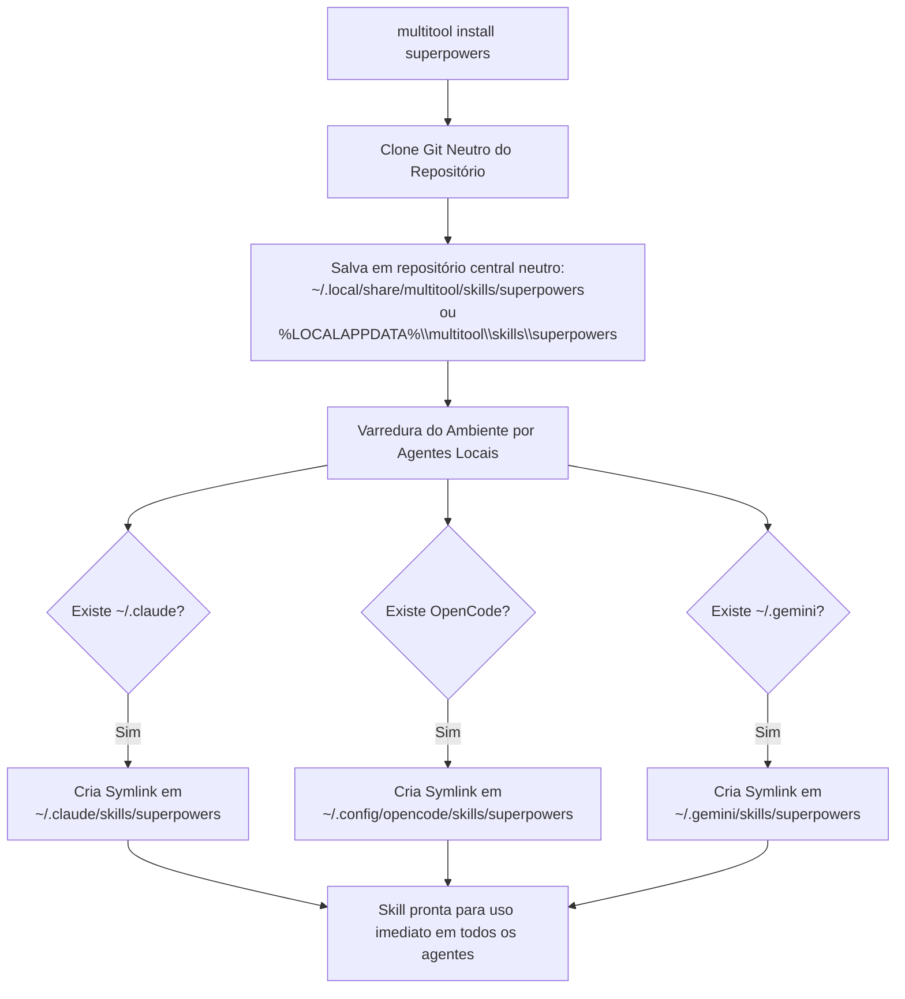

# Ciclo de Vida e Integração de Skills para Agentes de IA

Um dos recursos mais inovadores do **Multitool** é a gestão nativa e transparente de **Skills de IA**.

---

## 💡 O que são Agent Skills?

Skills são diretórios contendo regras operacionais padronizadas em Markdown (frequentemente com um arquivo central `SKILL.md`), scripts e ferramentas auxiliares que orientam agentes de inteligência artificial sobre metodologias específicas (TDD, microinterações, modding, revisão de código ou segurança).

---

## 🔄 Fluxo de Instalação e Linking

Quando você instala qualquer skill (individualmente ou via `@skills`), o Multitool realiza o ciclo completo sem necessidade de configuração manual:



---

## 📍 Localizações por Sistema Operacional

### 1. Repositório Neutro (Clone Central)
* **Linux / macOS**: `~/.local/share/multitool/skills/<id>`
* **Windows**: `%LOCALAPPDATA%\multitool\skills\<id>`

### 2. Destinos de Symlinks por Agente Detectado

| Agente de IA | Caminho no Linux / macOS | Caminho no Windows |
| :--- | :--- | :--- |
| **Claude Code** | `~/.claude/skills/<id>` | `%USERPROFILE%\.claude\skills\<id>` |
| **OpenCode** | `~/.config/opencode/skills/<id>` | `%LOCALAPPDATA%\opencode\skills\<id>` |
| **Gemini CLI / Antigravity** | `~/.gemini/skills/<id>` e `~/.gemini/config/skills/<id>` | `%USERPROFILE%\.gemini\skills\<id>` e `%USERPROFILE%\.gemini\config\skills\<id>` |
| **Codex** | `~/.codex/skills/<id>` e `~/.agents/skills/<id>` | `%USERPROFILE%\.codex\skills\<id>` e `%USERPROFILE%\.agents\skills\<id>` |

Se o agente for instalado posteriormente, basta executar `multitool update @skills` (ou `multitool sync`) para que os links sejam atualizados e criados automaticamente.

O **Codex** é detectado pela presença de `~/.codex`, `~/.agents` ou do executável `codex` no PATH, provisionando os destinos em `~/.codex/skills` e `~/.agents/skills`. O **Antigravity** é detectado via `~/.gemini`, `~/.gemini/config`, `~/.gemini/antigravity` ou binário `agy`/`antigravity`, provisionando os destinos em `~/.gemini/skills` e `~/.gemini/config/skills`.

Além disso, o Multitool realiza **descoberta granular de sub-skills**: se um repositório como Superpowers ou AddyOsmani contiver múltiplos pacotes em pastas internas (ex: `skills/<nome>/SKILL.md`), cada skill individual é linkada diretamente no primeiro nível do agente, garantindo que o `SKILL.md` seja descoberto nativamente por todos os runtimes de IA.

No Windows, quando o usuário não possui permissão para criar symlinks, o Multitool usa uma junção de diretório NTFS para caminhos locais. Skills já existentes no destino são preservadas, inclusive na desinstalação.

---

## 🧹 Desinstalação Limpa

Ao executar:
```bash
multitool uninstall superpowers
```
O Multitool:
1. Localiza todos os symlinks nos agentes instalados (`.claude`, `.config/opencode`, `.gemini`, `.codex`, `.agents`).
2. Remove todos os links criados (incluindo sub-skills granularmente mapeadas) de forma limpa.
3. Remove o clone do diretório neutro central.
4. Desregistra a ferramenta no arquivo `installed.json`.
