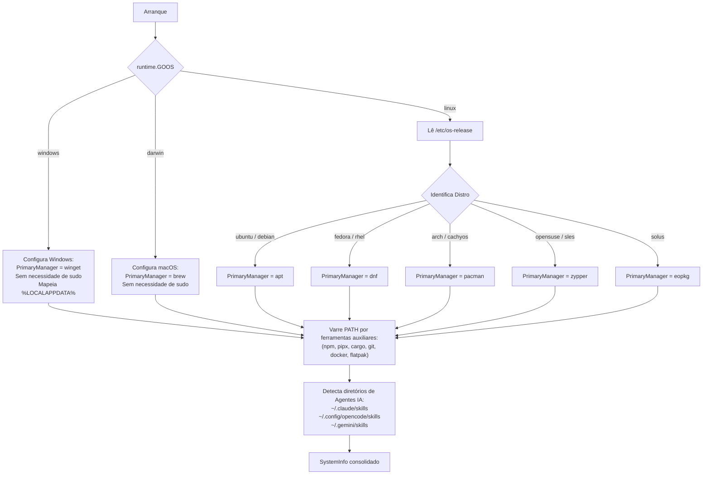

# Arquitetura e Design do Sistema

Este documento descreve a estrutura interna, os módulos fundamentais e o fluxo de dados do **Multitool**.

---

## 1. Visão Geral da Arquitetura

O Multitool foi projetado em **Go puro**, sem dependências de CGO, permitindo compilação estática simples para qualquer sistema operacional e arquitetura.

```
┌─────────────────────────────────────────────────────────────┐
│                       main.go                               │
└──────────────────────────────┬──────────────────────────────┘
                               │
                ┌──────────────┴──────────────┐
                ▼                             ▼
       [ cmd/root.go ] (CLI)         [ internal/tui ] (TUI)
        Cobra Subcommands             Bubble Tea & Lip Gloss
                │                             │
                └──────────────┬──────────────┘
                               ▼
        ┌──────────────────────────────────────────────┐
        │             internal/runner                  │
        │   Orquestrador de Execução & Auditoria       │
        └───────┬──────────────┬───────────────┬───────┘
                │              │               │
                ▼              ▼               ▼
      [ internal/system ] [ internal/catalog ] [ internal/registry ]
        Detecção de SO,      Catálogo Universal   Controle de Estado
        Distro & Runtimes    com Alvos Duplos     JSON em Disco
```

---

## 2. Pipeline de Detecção de Ambiente (`internal/system`)

A detecção ocorre dinamicamente no arranque do binário em 4 etapas lineares:

A detecção apenas lê o sistema. Os diretórios de skills são criados pelo runner durante o provisionamento real, nunca pela descoberta de agentes.



### Estrutura `SystemInfo`
```go
type SystemInfo struct {
    OS             OSType          `json:"os"`
    Arch           string          `json:"arch"`
    Distro         LinuxDistro     `json:"distro,omitempty"`
    DistroPretty   string          `json:"distro_pretty,omitempty"`
    PrimaryManager PkgManager      `json:"primary_manager"`
    HasSudo        bool            `json:"has_sudo"`
    NeedsSudo      bool            `json:"needs_sudo"`
    AvailableTools map[string]bool `json:"available_tools"`
    SkillDirs      []string        `json:"skill_dirs"`
}
```

---

## 3. Modelo de Catálogo com Alvos Múltiplos (`internal/catalog`)

Em vez de criar catálogos separados por sistema operacional, cada ferramenta é definida como uma entidade única com alvos opcionais para **Windows**, **Linux** e **macOS (Darwin)**:

```go
type TargetType string

const (
    TypeWinget  TargetType = "winget"
    TypeNative  TargetType = "native"  // apt, dnf, pacman, etc.
    TypeNpm     TargetType = "npm"
    TypePipx    TargetType = "pipx"
    TypeCargo   TargetType = "cargo"
    TypeSkill   TargetType = "skill"
    TypeFlatpak TargetType = "flatpak"
    TypeScript  TargetType = "script"
    TypeDirect  TargetType = "direct"
    TypeBrew    TargetType = "brew"
)

type Target struct {
    Type      TargetType `json:"type"`
    PackageID string     `json:"package_id"`
    Binary    string     `json:"binary"`
    SHA256    string     `json:"sha256,omitempty"` // Checksum de integridade
    ArtifactSHA256 map[string]string `json:"artifact_sha256,omitempty"`
}

type Tool struct {
    ID          string   `json:"id"`
    Name        string   `json:"name"`
    Category    string   `json:"category"`
    Description string   `json:"description"`
    Dependencies []string `json:"dependencies,omitempty"`
    Windows     *Target  `json:"windows,omitempty"`
    Linux       *Target  `json:"linux,omitempty"`
    Darwin      *Target  `json:"darwin,omitempty"`
}
```

### Resolução em Tempo de Execução
* `t.TargetForCurrentOS()`: Retorna o ponteiro `*Target` adequado ao SO atual. No macOS (`darwin`), utiliza o alvo dedicado `Darwin` ou realiza fallback seguro para ferramentas universais (`npm`, `pipx`, `cargo`, `skill`).
* `t.IsSupportedOnCurrentOS()`: Retorna `true` se a ferramenta possuir receita para a plataforma em execução.
* Se um usuário no Linux tentar instalar uma ferramenta exclusiva de Windows (ou vice-versa), o Multitool emite um aviso informativo e ignora o item com segurança sem travar o lote.

### Árvore de Dependências no Catálogo (DAG & Resolução Topológica)
* O campo `Dependencies: []string` permite declarar requisitos diretos entre ferramentas (ex: `ghidra` requer `temurin`, `keep`/`opengym`/`openstock` requerem `docker`, `ohmyzsh` requer `zsh`, `flathub` requer `flatpak`).
* `catalog.ResolveDependencies(args []string)`: Executa expansão de suítes/aliases, ordenação topológica por grafo direcionado acíclico (DAG) e detecção recursiva de ciclos via call-stack (`inStack`).
* Dependências satisfeitas no host (`r.IsDependencySatisfied`) ou já registradas são identificadas inteligentemente para evitar reinstalações desnecessárias.

---

## 4. Motor de Execução e Privilégios (`internal/runner`)

O módulo `Runner` centraliza a execução de comandos, testes em mock (`CommandExecutor`), auditoria e isolamento de permissões:

* **Auto-provisionamento Proativo de Runtimes (`ensureRuntime`)**:
  - Quando uma ferramenta do tipo `TypeNpm`, `TypePipx`, `TypeCargo`, `TypeFlatpak` ou `TypeSkill` é acionada e o comando correspondente (`npm`, `pipx`, `cargo`, `flatpak`, `git`) não existe no PATH do hospedeiro (`LookPath`), o Multitool auto-provisiona o runtime automaticamente via gerenciador nativo da plataforma (`apt`, `dnf`, `pacman`, `zypper`, `eopkg`, `brew`, `winget`).
* **Executor Desacoplado (`CommandError`) & Diagnósticos Limpos**:
  - `OSExecutor` executa processos externos, sincroniza o dreno dos pipes de saída e retorna erros estruturados `*CommandError` com as últimas linhas capturadas (`RecentLines`), sem acoplar regras de domínio de gerenciadores (como códigos HRESULT do Winget) e sem escrever sobre o `Spinner` ativo.
  - O `Runner` interpreta códigos benignos (ex: `0x8A15002B`, `0x8A150061`, `0x8A15010D`, `0x8A15010E`, `3010`, `1641` definidos em `internal/runner/winget_codes.go`) e só imprime o bloco de diagnóstico (`│`) após o `sp.Stop(...)` em falhas reais.
  - Em modo `--verbose` (`-v`), o spinner é desativado e `stdout`/`stderr` dos instaladores são exibidos em tempo real.
* **Fast-Path de Detecção Prévia (`isToolPresentOnHost`)**:
  - Antes de invocar gerenciadores externos durante `install`, o runner verifica se o binário ou diretório de skill já existe no host. Em caso positivo (e sem `--force`/`--reinstall`), sincroniza `installed.json` imediatamente sem esperar pelo gerenciador externo.
* **Paralelismo Inteligente em `@skills` e Downloads Portáteis `TypeDirect`**:
  - Clones de skills Git (Linux/macOS `TypeSkill` e Windows `TypeDirect`) e downloads portáteis isolados (`apktool`, `ghidra`, `wabt`, quando suas dependências estão satisfeitas) são processados concorrentemente em worker pools de 4 goroutines, mantendo instaladores MSI/NSIS (`craftlauncher`, `orca`, `openmausbot`) serializados.
* **Auditoria de Saúde (`multitool doctor` / `check`)**:
  - Verifica gerenciador primário, runtimes auxiliares, presença do diretório local de binários no `PATH`, validade dos binários registrados em `installed.json` e integridade dos symlinks/junções de skills.
* **Validação Criptográfica de Integridade (SHA-256)**:
  - Downloads diretos usam diretórios temporários exclusivos. O runner verifica `SHA256` antes de executar, extrair ou publicar o artefato; divergências abortam a operação e removem os temporários.
  - `ArtifactSHA256` permite hashes por nome de arquivo, inclusive para receitas com vários downloads ou assets diferentes por arquitetura. Use este campo ou `SHA256`, não ambos. Downloads sem hash emitem aviso; o catálogo ainda não fornece hashes. Scripts de bootstrap podem baixar outros arquivos sob a política do instalador upstream.
* **Erros em Lotes**:
  - As variantes `RunBatch*WithErrors` preservam os contadores e acumulam erros por ferramenta com `errors.Join`. A CLI retorna erro após qualquer falha, sem interromper os demais itens do lote.
* **Consultas de Releases**:
  - `ReleaseTagResolver` permite substituir a consulta de versões junto com o executor de comandos. Somente o executor real consulta o GitHub, com timeout de 4 segundos.
* **Sincronização de Estado com o Host (`multitool sync`)**:
  - Inspeciona o `$PATH` do sistema operacional para identificar ferramentas do catálogo pré-instaladas fora do Multitool, registrando-as automaticamente em `installed.json` e re-linkando skills existentes para agentes recém-descobertos.
* **Privilégios Sudo**: No Linux, para pacotes do tipo `TypeNative`, o comando é prefixado com `sudo` apenas se `sysInfo.NeedsSudo == true` (`os.Geteuid() != 0`).
* **Simulação (`--dry-run`)**: Quando ativo, nenhum processo do sistema é gerado. Apenas o log de auditoria é preenchido e o estado é simulado.
* **Auditoria com Rotação (`logGira`)**:
  - Salva em `%LOCALAPPDATA%\multitool\multitool.log` (Windows) ou `~/.local/share/multitool/multitool.log` (Linux/macOS).
  - Quando o arquivo ultrapassa **512 KB**, ele é rotacionado automaticamente mantendo apenas a porção mais recente.

---

## 5. Registro de Estado Persistente (`internal/registry`)

O estado das ferramentas instaladas usa `sync.RWMutex` e lock de arquivo (`flock` no Linux/macOS e `LockFileEx` no Windows). Cada alteração relê o JSON sob o lock para preservar atualizações de outros processos.

A gravação usa um temporário no mesmo diretório, `Sync`, fechamento e substituição do destino. Linux/macOS usam `os.Rename` e sincronizam o diretório; Windows usa `MoveFileEx` com substituição e sincronização solicitada, além de tentativas limitadas para erros transitórios de compartilhamento. O arquivo `.lock` permanece no disco; o bloqueio é liberado pelo sistema quando o processo termina.

* **Caminho no Linux**: `~/.local/share/multitool/installed.json`
* **Caminho no Windows**: `%LOCALAPPDATA%\multitool\installed.json`

Exemplo do arquivo `installed.json`:
```json
{
  "btop": {
    "timestamp": 1729550400,
    "os": "linux"
  },
  "ollama": {
    "timestamp": 1729550415,
    "os": "linux"
  }
}
```
Operações como `MarkInstalled`, `MarkUninstalled` e `IsInstalled` são idempotentes.
