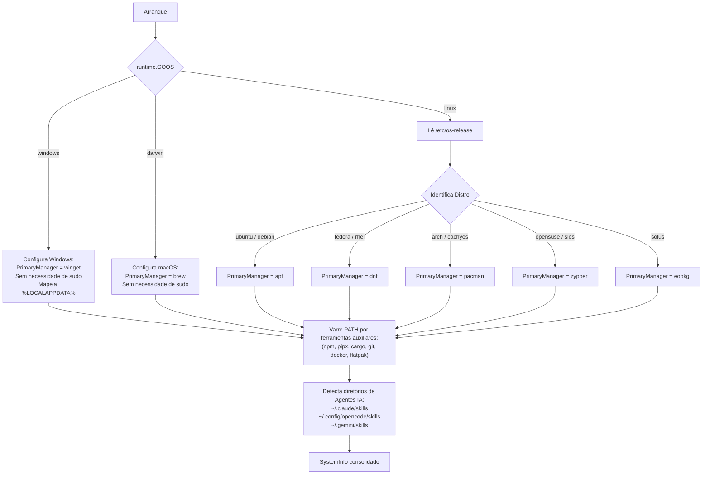

# Arquitetura e Design do Sistema

Este documento descreve a estrutura interna, os módulos fundamentais e o fluxo de dados do **Multitool**.

---

## 1. Visão Geral da Arquitetura

O Multitool foi projetado em **Go puro**, sem dependências de CGO, permitindo compilação estática simples para qualquer sistema operacional e arquitetura.

```
┌─────────────────────────────────────────────────────────────┐
│                       main.go                               │
└──────────────────────────────┬──────────────────────────────┘
                               │
                ┌──────────────┴──────────────┐
                ▼                             ▼
       [ cmd/root.go ] (CLI)         [ internal/tui ] (TUI)
        Cobra Subcommands             Bubble Tea & Lip Gloss
                │                             │
                └──────────────┬──────────────┘
                               ▼
        ┌──────────────────────────────────────────────┐
        │             internal/runner                  │
        │   Orquestrador de Execução & Auditoria       │
        └───────┬──────────────┬───────────────┬───────┘
                │              │               │
                ▼              ▼               ▼
      [ internal/system ] [ internal/catalog ] [ internal/registry ]
        Detecção de SO,      Catálogo Universal   Controle de Estado
        Distro & Runtimes    com Alvos Duplos     JSON em Disco
```

---

## 2. Pipeline de Detecção de Ambiente (`internal/system`)

A detecção ocorre dinamicamente no arranque do binário em 4 etapas lineares:



### Estrutura `SystemInfo`
```go
type SystemInfo struct {
    OS             OSType          `json:"os"`
    Arch           string          `json:"arch"`
    Distro         LinuxDistro     `json:"distro,omitempty"`
    DistroPretty   string          `json:"distro_pretty,omitempty"`
    PrimaryManager PkgManager      `json:"primary_manager"`
    HasSudo        bool            `json:"has_sudo"`
    NeedsSudo      bool            `json:"needs_sudo"`
    AvailableTools map[string]bool `json:"available_tools"`
    SkillDirs      []string        `json:"skill_dirs"`
}
```

---

## 3. Modelo de Catálogo com Alvos Múltiplos (`internal/catalog`)

Em vez de criar catálogos separados por sistema operacional, cada ferramenta é definida como uma entidade única com alvos opcionais para **Windows** e **Linux**:

```go
type TargetType string

const (
    TypeWinget  TargetType = "winget"
    TypeNative  TargetType = "native"  // apt, dnf, pacman, etc.
    TypeNpm     TargetType = "npm"
    TypePipx    TargetType = "pipx"
    TypeCargo   TargetType = "cargo"
    TypeSkill   TargetType = "skill"
    TypeFlatpak TargetType = "flatpak"
    TypeScript  TargetType = "script"
    TypeDirect  TargetType = "direct"
)

type Target struct {
    Type      TargetType `json:"type"`
    PackageID string     `json:"package_id"`
    Binary    string     `json:"binary"`
    Script    string     `json:"script,omitempty"`
}

type Tool struct {
    ID          string  `json:"id"`
    Name        string  `json:"name"`
    Category    string  `json:"category"`
    Description string  `json:"description"`
    Windows     *Target `json:"windows,omitempty"`
    Linux       *Target `json:"linux,omitempty"`
}
```

### Resolução em Tempo de Execução
* `t.TargetForCurrentOS()`: Retorna o ponteiro `*Target` adequado ao SO atual.
* `t.IsSupportedOnCurrentOS()`: Retorna `true` se a ferramenta possuir receita para a plataforma em execução.
* Se um usuário no Linux tentar instalar uma ferramenta exclusiva de Windows (ou vice-versa), o Multitool emite um aviso informativo e ignora o item com segurança sem travar o lote.

### Árvore de Dependências no Catálogo (DAG & Resolução Topológica)
* O campo `Dependencies: []string` permite declarar requisitos diretos entre ferramentas (ex: `ghidra` requer `temurin`, `keep`/`opengym`/`openstock` requerem `docker`, `ohmyzsh` requer `zsh`, `flathub` requer `flatpak`).
* `catalog.ResolveDependencies(args []string)`: Executa expansão de suítes/aliases, ordenação topológica por grafo direcionado acíclico (DAG) e detecção recursiva de ciclos via call-stack (`inStack`).
* Dependências satisfeitas no host (`r.IsDependencySatisfied`) ou já registradas são identificadas inteligentemente para evitar reinstalações desnecessárias.

---

## 4. Motor de Execução e Privilégios (`internal/runner`)

O módulo `Runner` centraliza a execução de comandos, testes em mock (`CommandExecutor`), auditoria e isolamento de permissões:

* **Auto-provisionamento Proativo de Runtimes (`ensureRuntime`)**:
  - Quando uma ferramenta do tipo `TypeNpm`, `TypePipx`, `TypeCargo`, `TypeFlatpak` ou `TypeSkill` é acionada e o comando correspondente (`npm`, `pipx`, `cargo`, `flatpak`, `git`) não existe no PATH do hospedeiro (`LookPath`), o Multitool auto-provisiona o runtime automaticamente via gerenciador nativo da plataforma (`apt`, `dnf`, `pacman`, `zypper`, `eopkg`, `brew`, `winget`).
* **Privilégios Sudo**: No Linux, para pacotes do tipo `TypeNative`, o comando é prefixado com `sudo` apenas se `sysInfo.NeedsSudo == true` (`os.Geteuid() != 0`).
* **Simulação (`--dry-run`)**: Quando ativo, nenhum processo do sistema é gerado. Apenas o log de auditoria é preenchido e o estado é simulado.
* **Auditoria com Rotação (`logGira`)**:
  - Salva em `%LOCALAPPDATA%\multitool\multitool.log` (Windows) ou `~/.local/share/multitool/multitool.log` (Linux/macOS).
  - Quando o arquivo ultrapassa **512 KB**, ele é rotacionado automaticamente mantendo apenas a porção mais recente.

---

## 5. Registro de Estado Persistente (`internal/registry`)

O estado das ferramentas instaladas é persistido em um arquivo JSON thread-safe com suporte a concorrência via `sync.RWMutex`:

* **Caminho no Linux**: `~/.local/share/multitool/installed.json`
* **Caminho no Windows**: `%LOCALAPPDATA%\multitool\installed.json`

Exemplo do arquivo `installed.json`:
```json
{
  "btop": {
    "timestamp": 1729550400,
    "os": "linux"
  },
  "ollama": {
    "timestamp": 1729550415,
    "os": "linux"
  }
}
```
Operações como `MarkInstalled`, `MarkUninstalled` e `IsInstalled` são idempotentes.
